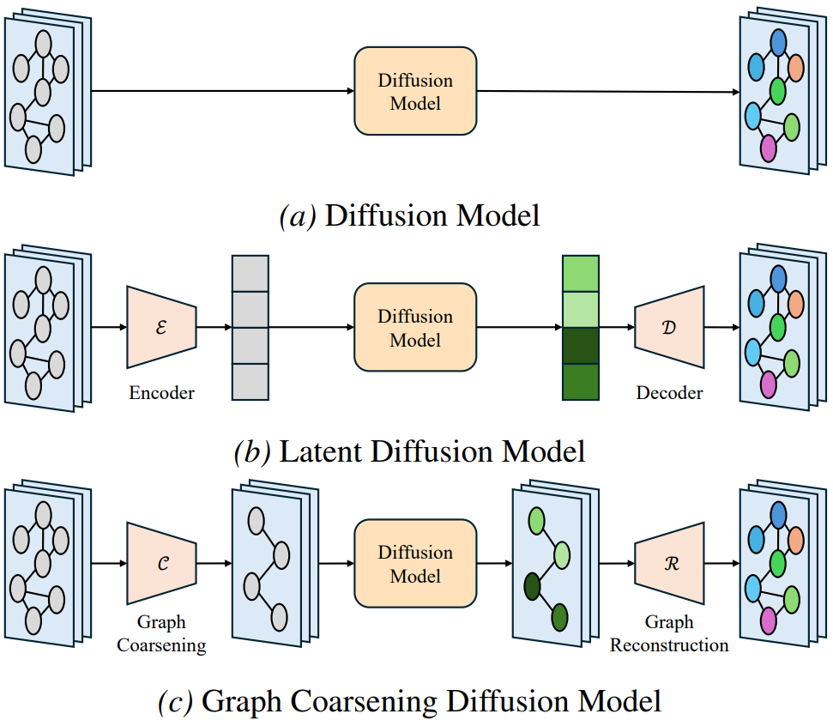

# Redefining Latent Spaces for Scalable Spatio-Temporal Graph Diffusion

This repository contains the Pytorch implementation code for the paper "Redefining Latent Spaces for Scalable Spatio-Temporal Graph Diffusion"

## Architectures



## Dependencies
- CUDA 12.8
- python 3.11.0
- pytorch 2.7.0
- torch-geometric 2.6.1
- ema-pytorch 0.7.7
- hydra-core 1.3.2

## Datasets
We used three benchmark datasets; SD, GBA, and GLA.

## Usage
You can train graph coarsening using the following commands.

```
python train_pooler.py
```

You can train diffusion with trained graph coarsening module using the following commands.

```
python train_diffusion.py pooler_ckpt=[graph coarsening module path]
```

You can use the following commands if you want to run with GPUs.

```
python train_pooler.py device=cuda
python train_diffusion.py pooler_ckpt=[graph coarsening module path] device=cuda
```

## Hyperparameters
You can change hyperparameters through the additional command "{name}={value}"

For example:

```
python train_pooler.py dataset=GBA num_cnodes=1176
python train_diffusion.py pooler_ckpt=[graph coarsening module path] dataset=GBA num_cnodes=1176
```

Please check [config.yaml](config.yaml) for the hyperparameters.
